# 校园新闻网站

> 🎓 **计算机毕业设计 · 校园新闻网站**
>
> 本仓库只放**项目介绍 + 运行截图**（截图是站点带水印的原图，存在仓库 `images/` 里）。
>
> 👉 **完整可运行源码 / 数据库脚本 / 部署文档：[点我获取](https://geekcode.top/archives/%E6%A0%A1%E5%9B%AD%E6%96%B0%E9%97%BB%E7%BD%91%E7%AB%99?utm_source=github)**
>
> 💬 咨询微信：**ir9372**　|　🌐 更多项目：[极客代码 geekcode.top](https://geekcode.top/?utm_source=github)
>
> 📌 项目详情页：<https://geekcode.top/archives/%E6%A0%A1%E5%9B%AD%E6%96%B0%E9%97%BB%E7%BD%91%E7%AB%99?utm_source=github>

<table><td width="230" align="center"> <b>扫码加微信 ir9372</b></td><td valign="middle">📦 源码 = 项目介绍 + 全部运行截图 + 数据库 + 部署文档 👉 点上方任意截图，直接跳到 <b>极客代码 geekcode.top</b> 详情页</td></table>

---

<h1>校园新闻网站</h1>
<h2>项目概述</h2>

校园新闻网站旨在为高校师生及社会公众提供一个集信息发布、互动交流与内容管理于一体的综合性平台。项目核心功能涵盖校园新闻浏览、论坛交流讨论、留言反馈以及个人中心管理。系统采用前后端分离架构，后端基于 Spring Boot 构建 RESTful API，前端使用 Vue 框架实现交互界面。通过 Shiro 进行安全权限控制，MyBatis-Plus 简化数据持久层操作。该项目适用于高校内部资讯传播、学生社团活动宣传及校园舆情收集场景，能够有效提升信息传递效率，增强用户互动体验，并为管理员提供高效的内容审核与维护工具。

<h2>技术架构</h2>
<h3>整体架构设计</h3>

本项目采用经典的前后端分离模式。后端服务运行于 Java 虚拟机环境，负责业务逻辑处理、数据存取及安全认证；前端应用独立部署，通过 HTTP 协议与后端接口通信，负责页面渲染与用户交互。这种架构降低了系统耦合度，便于并行开发与后期维护。

<h3>核心技术选型</h3>
<ol>
<li><strong>后端框架</strong>：选用 Spring Boot 作为核心开发框架，利用其自动配置特性快速搭建 Web 服务，集成 <code>spring-boot-starter-web</code> 提供 MVC 支持。</li>
<li><strong>持久层框架</strong>：采用 MyBatis-Plus (<code>mybatis-plus</code>) 结合 <code>mybatis-spring-boot-starter</code>。MyBatis-Plus 在保留 MyBatis 灵活性的基础上，提供了通用的 CRUD 方法，显著减少样板代码，提高开发效率。</li>
<li><strong>安全框架</strong>：引入 Apache Shiro (<code>shiro-spring</code>) 实现身份认证与授权管理，确保系统访问安全性，区分不同角色的权限边界。</li>
<li><strong>数据库</strong>：使用 MySQL 存储结构化数据，配合 <code>mysql-connector-java</code> 驱动连接。</li>
<li><strong>前端技术</strong>：基于 Vue.js 构建单页应用（SPA），通过 Axios 或 Fetch 调用后端接口，实现动态路由与组件化开发。</li>
</ol>
<h3>数据库设计要点</h3>

数据库主要围绕“用户”、“新闻”、“评论”、“收藏”及“配置”等实体进行建模。关键表包括：

<ul>
<li><strong>用户表 (yonghu)</strong>：存储注册用户的基本信息及账号状态。</li>
<li><strong>校园新闻表 (xiaoyuanxinwen)</strong>：记录新闻标题、内容、类型、发布时间及作者关联。</li>
<li><strong>新闻类型表 (xinwenleixing)</strong>：定义新闻分类字典，支持动态扩展类别。</li>
<li><strong>评论/论坛表 (discussxiaoyuanxinwen / forum)</strong>：存储用户对新闻或话题的回复内容，建立与新闻及用户的关联关系。</li>
<li><strong>收藏表 (storeup)</strong>：记录用户感兴趣的新闻条目，实现个性化推荐基础。</li>
<li><strong>留言板表 (messages)</strong>：存储前台用户的反馈意见。</li>
<li><strong>配置表 (config)</strong>：管理系统全局参数如轮播图、公告等。</li>
</ul>
<h2>功能模块</h2>
<h3>前台用户端</h3>

前台界面面向普通注册用户及游客，主要提供信息浏览与互动功能：

<ol>
<li><strong>首页展示</strong>：聚合展示最新校园新闻、热门论坛帖子及系统公告，提供直观的导航入口。</li>
<li><strong>校园新闻模块</strong>：<ul>
<li><strong>列表浏览</strong>：按时间或热度排序展示新闻摘要，支持分页加载。</li>
<li><strong>详情查看</strong>：点击新闻进入详情页，阅读完整内容及配图。</li>
<li><strong>评论互动</strong>：用户在新闻详情页发表观点，参与讨论。</li>
</ul>
</li>
<li><strong>论坛交流模块</strong>：<ul>
<li><strong>帖子列表</strong>：展示各类话题讨论区。</li>
<li><strong>发帖与回复</strong>：注册用户可以创建新话题或对现有帖子进行回复。</li>
</ul>
</li>
<li><strong>留言反馈模块</strong>：提供表单供用户提交对网站的建议或投诉，后台管理员可查阅。</li>
<li><strong>个人中心</strong>：<ul>
<li><strong>个人信息管理</strong>：修改头像、昵称、密码等基本资料。</li>
<li><strong>我的发布</strong>：查看自己发布的新闻或论坛帖子，支持编辑或删除。</li>
<li><strong>我的收藏</strong>：查看已收藏的新闻列表，方便快速回访。</li>
</ul>
</li>
</ol>
<h3>后台管理端</h3>

后台界面面向系统管理员，提供全面的数据管理与内容审核功能：

<ol>
<li><strong>系统登录与安全</strong>：管理员专属登录入口，集成 Shiro 权限验证。</li>
<li><strong>用户管理 (/yonghu)</strong>：查询、新增、编辑、删除前台注册用户，重置密码或禁用异常账号。</li>
<li><strong>校园新闻管理 (/xiaoyuanxinwen)</strong>：<ul>
<li><strong>内容录入</strong>：富文本编辑器支持图文混排，选择新闻类型后发布。</li>
<li><strong>审核与维护</strong>：修改已发布内容，删除违规或过时新闻。</li>
</ul>
</li>
<li><strong>新闻评论管理 (/discussxiaoyuanxinwen)</strong>：监控用户对新闻的评论，支持敏感词过滤后的手动删除或隐藏不良言论。</li>
<li><strong>论坛管理 (/forum)</strong>：管理论坛板块及帖子，维护社区秩序。</li>
<li><strong>新闻类型管理 (/xinwenleixing)</strong>：自定义新闻分类标签（如“教务通知”、“社团活动”、“学术讲座”），动态调整前台展示结构。</li>
<li><strong>留言板管理 (/messages)</strong>：查阅用户提交的反馈信息，标记处理状态或直接回复。</li>
<li><strong>收藏管理 (/storeup)</strong>：统计热门收藏数据，辅助运营分析。</li>
<li><strong>系统配置 (/config)</strong>：设置网站名称、Logo、轮播图等全局参数。</li>
</ol>
<h2>用户角色与权限</h2>

本系统主要划分为两类角色：<strong>普通用户</strong>和<strong>管理员</strong>。根据代码中的 Controller 划分及 Shiro 配置，具体权限如下：

<table>
<thead>
<tr>
<th align="left">角色</th>
<th align="left">功能权限描述</th>
<th align="left">可访问模块/路径</th>
</tr>
</thead>
<tbody><tr>
<td align="left"><strong>普通用户</strong></td>
<td align="left">1. <strong>浏览权限</strong>：无需登录即可浏览首页、新闻列表、论坛列表。2. <strong>互动权限</strong>：登录后方可发表评论、发帖、留言、收藏新闻。3. <strong>个人管理</strong>：仅能查看和管理自己发布的内容及收藏记录，不能修改他人数据。4. <strong>账户安全</strong>：修改个人基本信息和密码。</td>
<td align="left"><code>/index</code>, <code>/login</code>, <code>/register</code>, <code>/news/list</code>, <code>/news/detail</code>, <code>/forum/list</code>, <code>/forum/post</code>, <code>/user/center</code>, <code>/user/my-publish</code>, <code>/user/my-collection</code></td>
</tr>
<tr>
<td align="left"><strong>管理员</strong></td>
<td align="left">1. <strong>全量数据管理</strong>：拥有对所有用户、新闻、评论、论坛帖子的增删改查权限。2. <strong>内容审核</strong>：负责筛选优质内容，删除违规评论或帖子。3. <strong>系统配置</strong>：管理新闻分类字典、系统全局参数。4. <strong>反馈处理</strong>：直接回复或归档用户留言。5. <strong>数据统计</strong>：查看收藏管理等运营数据。</td>
<td align="left"><code>/admin/login</code>, <code>/admin/user</code>, <code>/admin/news</code>, <code>/admin/comment</code>, <code>/admin/forum</code>, <code>/admin/type</code>, <code>/admin/message</code>, <code>/admin/config</code>, <code>/admin/storeup</code></td>
</tr>
</tbody></table>

<em>注：普通用户无法访问任何以 <code>/admin</code> 开头的后台路由；未登录用户通常只能执行只读操作，写操作需经过 Shiro 认证拦截。</em>

<h2>项目特色与创新点</h2>
<ol>
<li><strong>模块化内容管理体系</strong>：通过独立的“新闻类型”管理模块，实现了内容分类的动态配置。管理员无需修改代码即可增加新的新闻栏目，提升了系统的灵活性和可扩展性。</li>
<li><strong>多维度的互动闭环</strong>：不仅包含传统的“新闻-评论”单向互动，还引入了“论坛”版块，支持话题式讨论。同时结合“留言反馈”机制，形成了从内容消费到意见收集的完整闭环，增强了用户粘性。</li>
<li><strong>轻量级高效开发架构</strong>：采用 Spring Boot + MyBatis-Plus 组合，极大减少了配置文件和重复代码量。Shiro 的集成确保了在不牺牲性能的前提下实现了细粒度的权限控制，适合中小型规模的高校应用场景。</li>
<li><strong>数据驱动的运营支持</strong>：后台保留了“我的收藏管理”视图，虽然不直接干预用户行为，但为管理员提供了热度数据分析的依据，有助于优化新闻推送策略。</li>
</ol>
<h2>部署环境</h2>

为确保校园新闻网站正常运行，需准备以下软件环境：

<ol>
<li><strong>操作系统</strong>：Windows 10/11, Linux (CentOS 7+/Ubuntu 20.04+), macOS。</li>
<li><strong>Java 运行环境</strong>：JDK 1.8 或 JDK 11（推荐 JDK 1.8 以保证兼容性）。</li>
<li><strong>数据库服务器</strong>：MySQL 5.7 或 MySQL 8.0。需安装并启动服务，创建对应数据库实例。</li>
<li><strong>Maven</strong>：Apache Maven 3.6+，用于后端项目的依赖管理和构建打包。</li>
<li><strong>Node.js</strong>：v14.x 或 v16.x LTS 版本，用于前端 Vue 项目的依赖安装（npm/yarn）及本地开发服务器启动。</li>
<li><strong>Web 服务器</strong>：Nginx（生产环境推荐，用于反向代理前端静态资源）或 Tomcat（Spring Boot 内置，可直接运行 jar 包）。</li>
<li><strong>浏览器</strong>：Chrome, Firefox, Edge 等现代浏览器（建议使用最新版本以获得最佳 Vue 渲染效果）。</li>
</ol>

<strong>部署步骤简述</strong>：

<ol>
<li>导入 SQL 脚本至 MySQL。</li>
<li>修改后端 <code>application.yml</code> 中的数据库连接信息。</li>
<li>使用 Maven 打包后端项目，生成 <code>.jar</code> 文件并运行。</li>
<li>进入前端目录，执行 <code>npm install</code> 安装依赖，随后 <code>npm run build</code> 生成静态文件。</li>
<li>将生成的静态文件部署至 Nginx 或 Spring Boot 的 static 目录下，配置跨域或反向代理规则。</li>
</ol>
<h2>五、技术特性</h2>
<ul>
<li>前后端集成部署，前端资源打包至后端 static 目录</li>
<li>使用 MyBatis-Plus 简化数据访问层开发</li>
<li>集成 Shiro 权限框架实现角色权限控制</li>
</ul>
<h2>六、功能模块截图</h2>
<h3>前台用户端</h3>
<h4>前台首页</h4>

<h4>前台登录页</h4>

<a href="https://geekcode.top/archives/%E6%A0%A1%E5%9B%AD%E6%96%B0%E9%97%BB%E7%BD%91%E7%AB%99?utm_source=github" title="查看完整源码">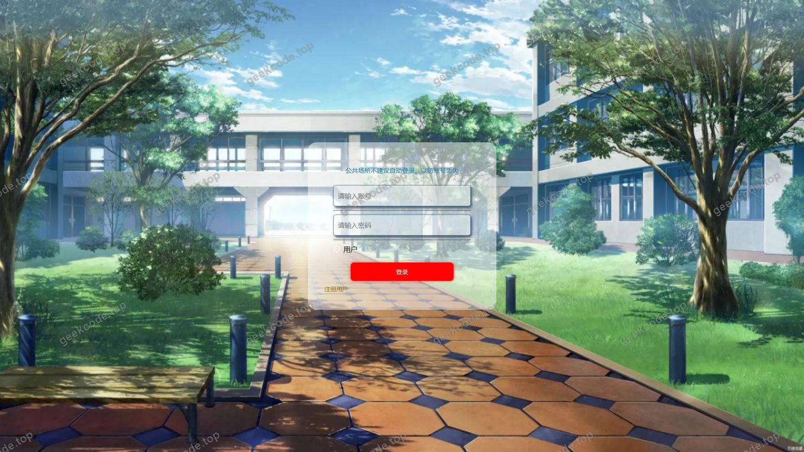</a>

<h4>前台注册页</h4>

<a href="https://geekcode.top/archives/%E6%A0%A1%E5%9B%AD%E6%96%B0%E9%97%BB%E7%BD%91%E7%AB%99?utm_source=github" title="查看完整源码">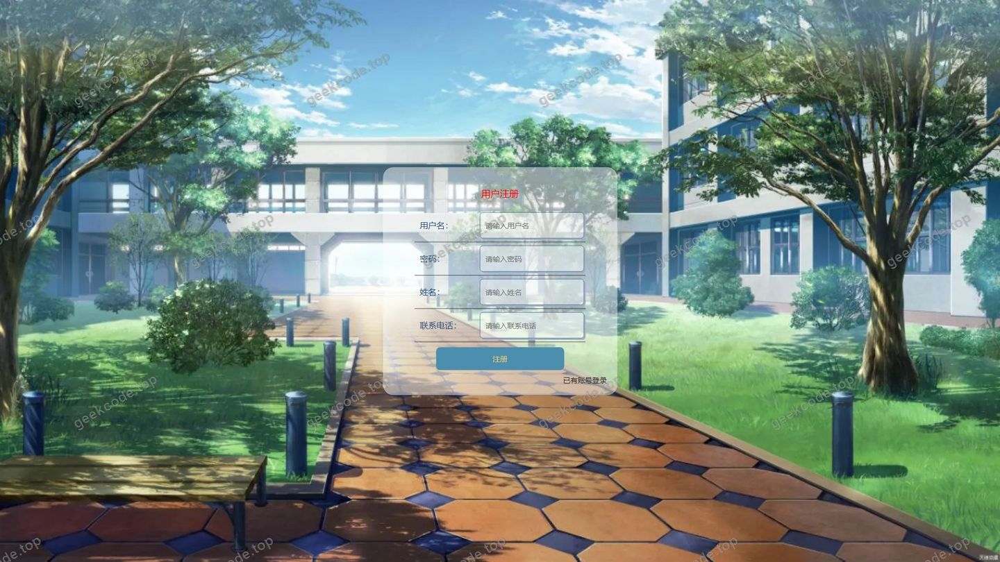</a>

<h4>前台-论坛交流列表</h4>

<h4>前台-校园新闻列表</h4>

<h4>前台个人中心</h4>

<a href="https://geekcode.top/archives/%E6%A0%A1%E5%9B%AD%E6%96%B0%E9%97%BB%E7%BD%91%E7%AB%99?utm_source=github" title="查看完整源码">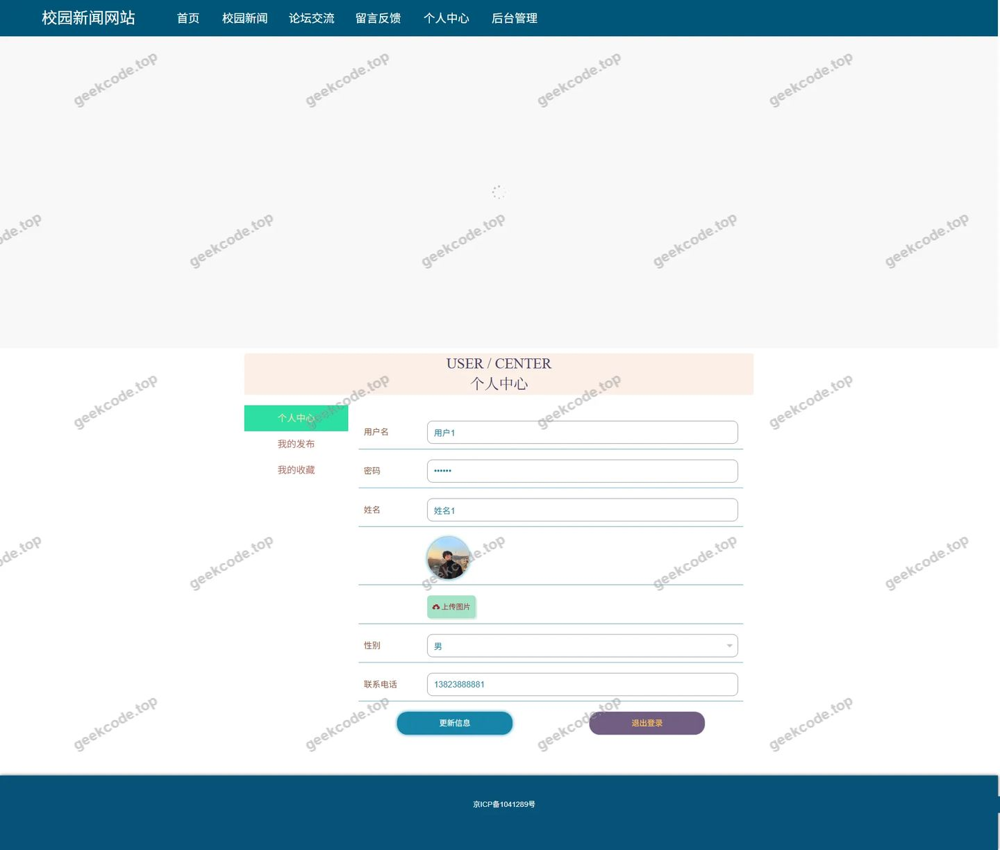</a>

<h4>前台-论坛交流详情</h4>

<h4>前台-校园新闻详情</h4>

<a href="https://geekcode.top/archives/%E6%A0%A1%E5%9B%AD%E6%96%B0%E9%97%BB%E7%BD%91%E7%AB%99?utm_source=github" title="查看完整源码">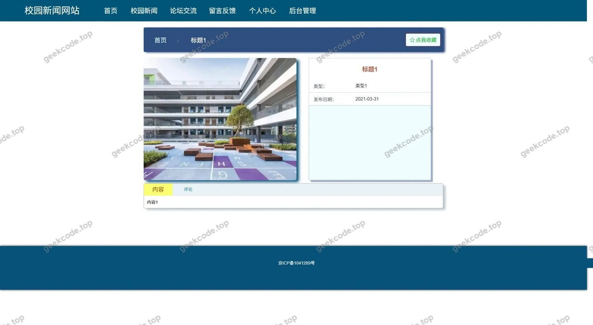</a>

<h3>后台管理端</h3>
<h4>后台-登录页</h4>

<a href="https://geekcode.top/archives/%E6%A0%A1%E5%9B%AD%E6%96%B0%E9%97%BB%E7%BD%91%E7%AB%99?utm_source=github" title="查看完整源码">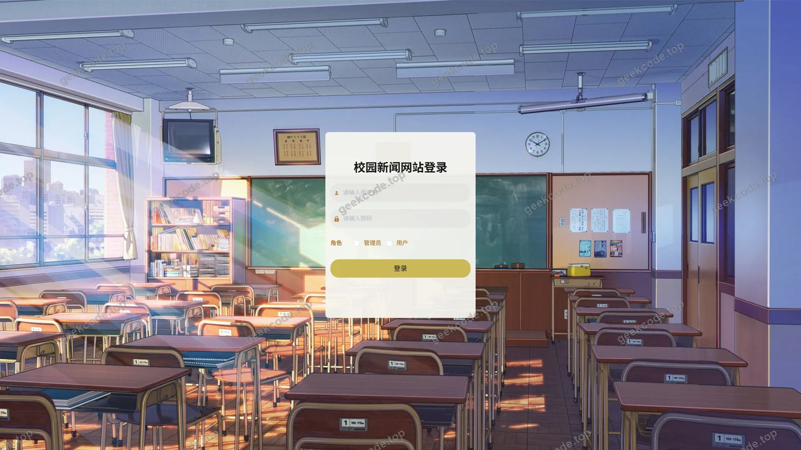</a>

<h4>后台-留言板管理</h4>

<a href="https://geekcode.top/archives/%E6%A0%A1%E5%9B%AD%E6%96%B0%E9%97%BB%E7%BD%91%E7%AB%99?utm_source=github" title="查看完整源码">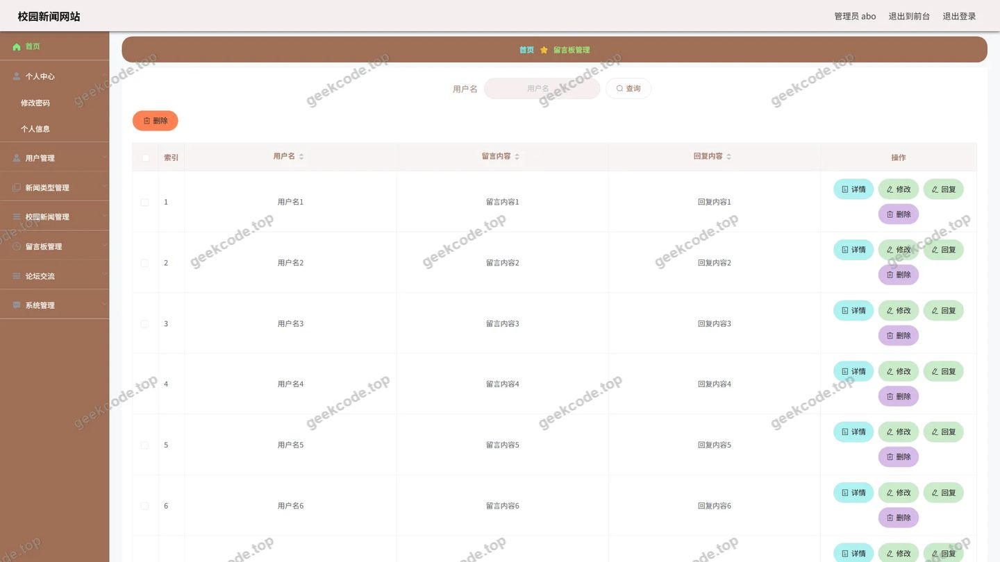</a>

<h4>后台-我的收藏管理</h4>

<a href="https://geekcode.top/archives/%E6%A0%A1%E5%9B%AD%E6%96%B0%E9%97%BB%E7%BD%91%E7%AB%99?utm_source=github" title="查看完整源码">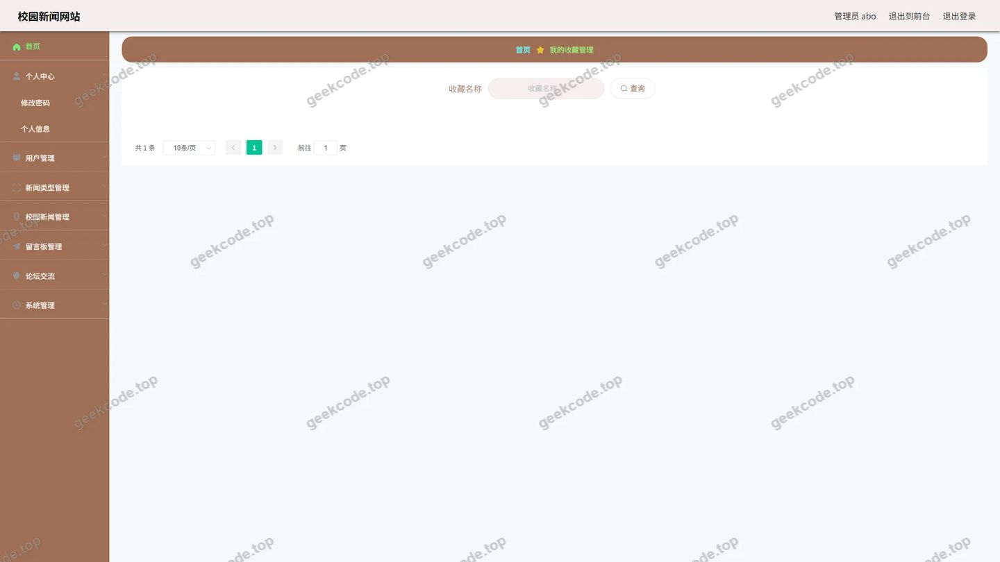</a>

<h4>后台首页</h4>

<a href="https://geekcode.top/archives/%E6%A0%A1%E5%9B%AD%E6%96%B0%E9%97%BB%E7%BD%91%E7%AB%99?utm_source=github" title="查看完整源码">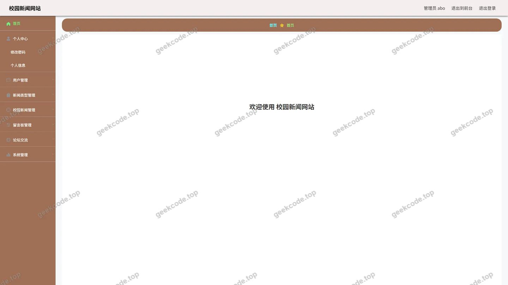</a>

<h4>后台-校园新闻</h4>

<a href="https://geekcode.top/archives/%E6%A0%A1%E5%9B%AD%E6%96%B0%E9%97%BB%E7%BD%91%E7%AB%99?utm_source=github" title="查看完整源码">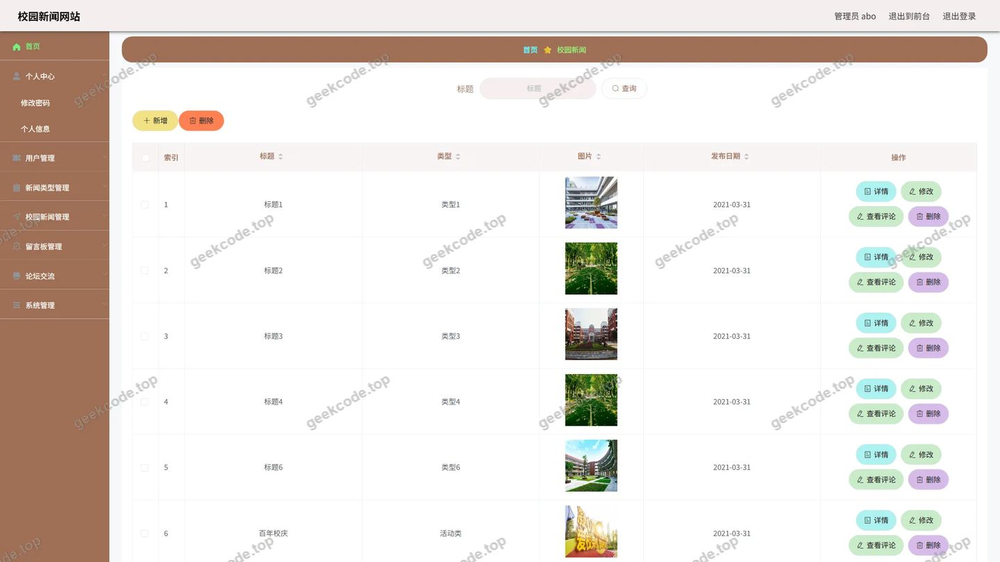</a>

<h4>后台-校园新闻评论</h4>

<a href="https://geekcode.top/archives/%E6%A0%A1%E5%9B%AD%E6%96%B0%E9%97%BB%E7%BD%91%E7%AB%99?utm_source=github" title="查看完整源码">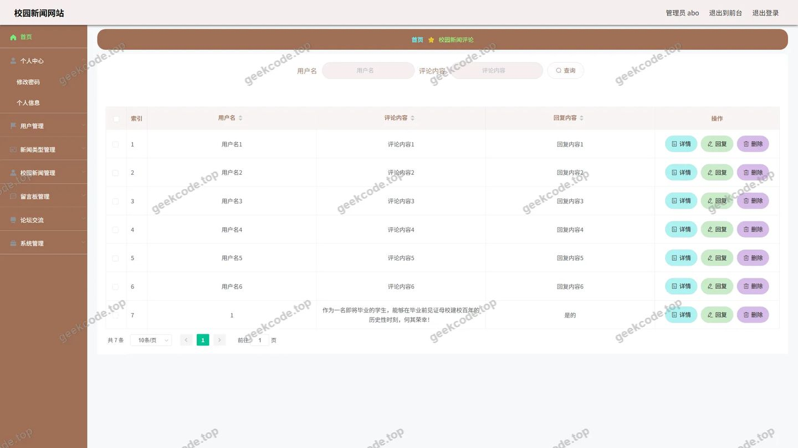</a>

<h4>后台-新闻类型</h4>

<a href="https://geekcode.top/archives/%E6%A0%A1%E5%9B%AD%E6%96%B0%E9%97%BB%E7%BD%91%E7%AB%99?utm_source=github" title="查看完整源码">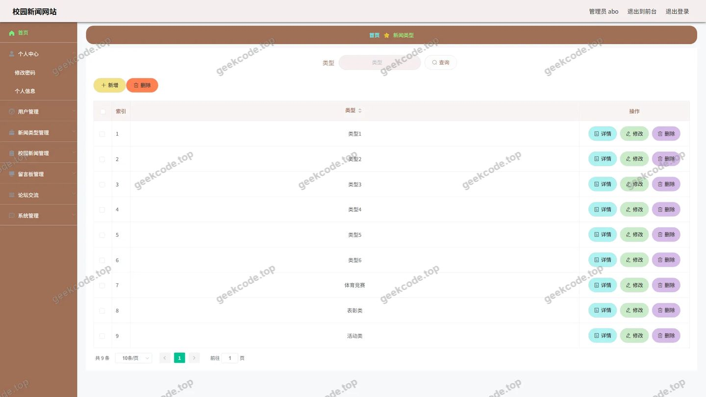</a>

<h4>后台-用户</h4>

<a href="https://geekcode.top/archives/%E6%A0%A1%E5%9B%AD%E6%96%B0%E9%97%BB%E7%BD%91%E7%AB%99?utm_source=github" title="查看完整源码">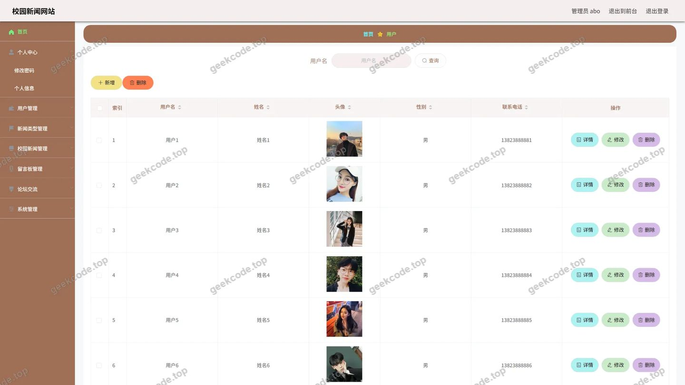</a>

---

## 获取完整源码

| 项目 | 说明 |
| --- | --- |
| 项目名 | 校园新闻网站 |
| 运行截图 | 本文 16 张（站点带水印原图，仓库 `images/` 目录） |
| 完整源码 | [https://geekcode.top/archives/%E6%A0%A1%E5%9B%AD%E6%96%B0%E9%97%BB%E7%BD%91%E7%AB%99?utm_source=github](https://geekcode.top/archives/%E6%A0%A1%E5%9B%AD%E6%96%B0%E9%97%BB%E7%BD%91%E7%AB%99?utm_source=github) |
| 咨询微信 | **ir9372**（备注：jingpin-yuanma） |
| 更多项目 | [极客代码 geekcode.top](https://geekcode.top/?utm_source=github) |

> 需要源码、部署、改配置、跑不起来等问题，加微信 ir9372 沟通，说明项目名即可。
